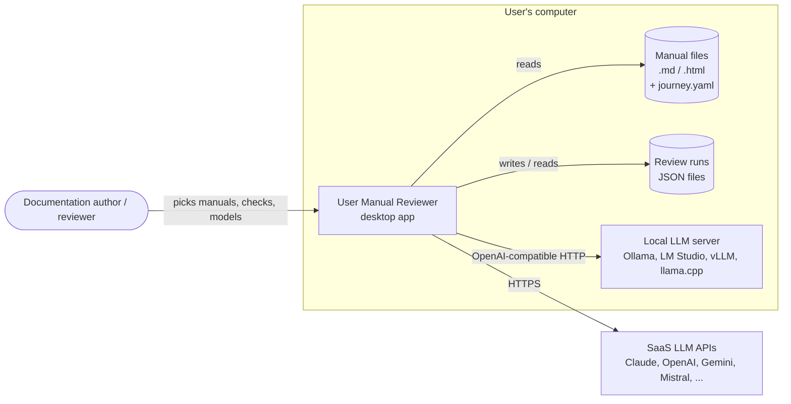
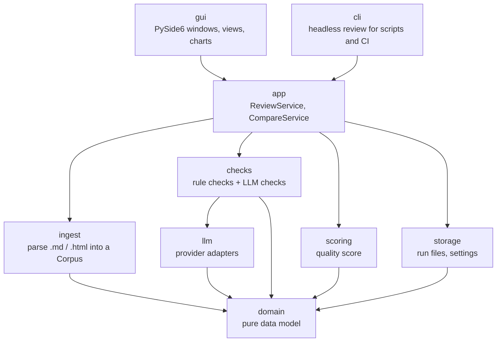
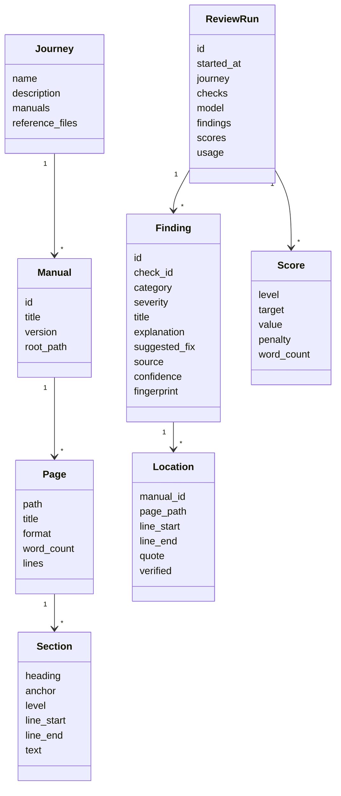
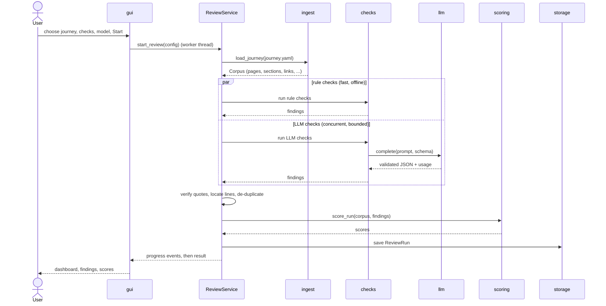
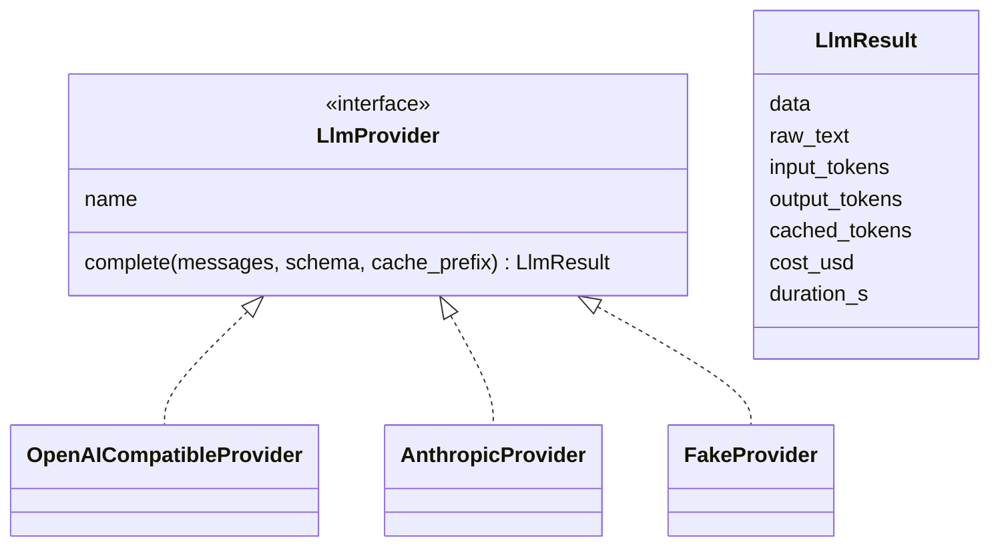

# Architecture design

> Read this page first, then skim the [ADRs](../adr/README.md). Together they explain what the application does, how it is built, and why.

## 1. What the application does

**User Manual Reviewer** is a desktop application that reviews a set of related user manuals (Markdown or HTML) and reports problems a reader would hit:

- duplicate sections, broken links and anchors, orphan pages, missing images
- inconsistencies inside one manual and contradictions between manuals
- gaps in the end-to-end user journey that the manuals together are supposed to cover
- terminology drift, UI label mismatches, prerequisite gaps, step order problems, undefined terms, stale versions, conflicting values, missing error paths, malformed code

Every finding points to the exact file, line and quoted text. The application computes a **quality score** (100% = no problems) for the whole set, each manual and each page, and can run the same review on **two LLMs side by side** to compare them.

## 2. Quality goals

| Priority | Goal | What it means here |
|---|---|---|
| 1 | **Trustworthy findings** | Every finding quotes the manual verbatim; quotes are verified against the source before they are shown ([ADR-0007](../adr/0007-finding-schema-and-verified-quotes.md)). |
| 2 | **LLM independence** | Any OpenAI-compatible endpoint (SaaS or local) works, configured in a file ([ADR-0003](../adr/0003-llm-access-openai-compatible-plus-native-claude.md), [ADR-0004](../adr/0004-llm-provider-config-file.md)). |
| 3 | **Understandability** | Small layers with one-way dependencies; this page plus the ADRs are enough to find your way. |
| 4 | **Cost awareness** | Deterministic checks never call an LLM; LLM prompts are built so providers can cache the manuals ([ADR-0006](../adr/0006-two-tier-checks.md)). |
| 5 | **Testability** | The core runs without a GUI and without network, using a fake LLM ([ADR-0011](../adr/0011-testing-strategy.md)). |

## 3. Context



The application has no server of its own. Manual text leaves the computer only when the user selects a SaaS model.

## 4. Building blocks



Dependencies point downwards only. `domain` imports nothing from the project. `gui` is the only package that imports PySide6, so everything else is testable as plain Python.

| Package | Responsibility | Key types |
|---|---|---|
| `domain` | Immutable data model shared by all layers | `Journey`, `Manual`, `Page`, `Section`, `Link`, `Finding`, `Location`, `Score`, `ReviewRun` |
| `ingest` | Read `journey.yaml` and `manual.yaml`, parse Markdown and HTML into pages and sections with line numbers, links, anchors, images, code blocks and word counts | `load_journey()`, `MarkdownParser`, `HtmlParser` |
| `checks` | One class per check, each declaring its id, tier (rule or LLM), scope (page, manual or journey) and the categories it reports | `Check`, `CheckRegistry`, `CheckContext` |
| `llm` | Send a prompt, get validated structured output back, report tokens, cost and time | `LlmProvider`, `OpenAICompatibleProvider`, `AnthropicProvider`, `FakeProvider` |
| `scoring` | Turn findings into scores for page, manual and set | `score_run()` |
| `storage` | Save and load review runs as JSON; load config files | `RunStore`, `load_providers()` |
| `app` | Orchestrate a review or a comparison; progress, cancellation, verification of quotes | `ReviewService`, `CompareService` |
| `gui` | Main window, setup view, results dashboard, finding detail, comparison view | `MainWindow`, view models |
| `cli` | `umr review journey.yaml --checks all --model claude` for automation and tests | — |

## 5. Data model



- A **journey** is the set of related manuals reviewed together, described by `journey.yaml` ([ADR-0005](../adr/0005-manual-and-journey-format.md)).
- A **finding** has zero or more locations: a broken link has one, a contradiction has two or more, a journey gap may have none.
- A **review run** is self-contained: it stores the configuration, the model used, all findings, scores and token usage, so it can be reopened, compared or shared later ([ADR-0009](../adr/0009-review-runs-as-json-files.md)).

## 6. Runtime: one review



- Rule checks finish in seconds and are shown immediately; LLM findings stream in as each check completes.
- LLM calls run concurrently with a configurable limit per provider; a run can be cancelled.
- **Quote verification**: each LLM finding must quote the manual. The quote is matched against the source (exact, then whitespace-normalised, then fuzzy ≥ 0.9). Unmatched quotes mark the finding *unverified*; they are shown greyed out and do not count in the score ([ADR-0007](../adr/0007-finding-schema-and-verified-quotes.md)).

## 7. Runtime: side-by-side comparison

`CompareService` runs (or reuses) two review runs on the same journey and checks with model A and model B, then matches findings:

1. Same check category, and
2. Overlapping locations (same page and overlapping lines) or quote similarity ≥ 0.8.

The comparison view shows three groups (found by both, only A, only B), both quality scores, and the time, tokens and cost of each model. Matching rules are in [ADR-0010](../adr/0010-side-by-side-comparison.md).

## 8. Checks

Checks come in two tiers ([ADR-0006](../adr/0006-two-tier-checks.md)):

| Tier | How it works | Examples |
|---|---|---|
| **Rule** | Deterministic Python over the parsed corpus. Free, fast, repeatable. | broken links and anchors, missing images and alt text, orphan pages, step numbering, near-duplicate sections, malformed JSON/YAML/CSV code blocks, UI labels not in `ui-strings.json`, conflicting version strings |
| **LLM** | A prompt with the relevant manual text and a JSON schema for findings. | contradictions, inconsistencies, journey gaps, terminology drift, prerequisite gaps, step order logic, undefined terms, conflicting values, missing error paths |

Some categories use both tiers: the rule tier finds candidates cheaply (for example every number with a unit, every defined term), and the LLM tier judges them.

**Prompt layout for caching**: the journey's manual text is always the first, identical block of the prompt, and the check instruction comes after it. Providers that cache prompt prefixes (Claude explicitly, OpenAI and Gemini automatically, local servers through their KV cache) then reuse the manuals across all checks of a run. If the manuals do not fit the model's configured context budget, the check runs per manual pair and per section group instead.

## 9. LLM provider layer



- **`OpenAICompatibleProvider`** (default) speaks the OpenAI Chat Completions API with a configurable `base_url`. It covers OpenAI, Gemini, Mistral, OpenRouter, Groq and local servers.
- **`AnthropicProvider`** (optional) uses the native Claude Messages API for explicit prompt caching and native structured outputs.
- **`FakeProvider`** returns recorded responses for tests.
- Structured output uses the strongest mode the provider supports (`json_schema`, then `json_object`, then prompt-only), set per provider in the config. Every response is validated with Pydantic; one retry with the validation error is allowed, after which the check reports an error instead of findings.

Providers are listed in `config/llm-providers.yaml` ([ADR-0004](../adr/0004-llm-provider-config-file.md)). API keys are never stored in that file; it names the environment variable that holds the key.

## 10. Quality score

```
penalty  = Σ severity_weight(f) for verified findings f in scope
density  = penalty / max(word_count, 300) × 1000
score    = 100 × e^(−density / k)
```

Default weights: critical 10, major 5, minor 2, info 0.5; default `k` = 20. A finding counts toward every page and manual it has a location in; journey-level findings (gaps with no location) count only toward the set score. Details and alternatives considered: [ADR-0008](../adr/0008-quality-score.md).

## 11. GUI

| View | Content |
|---|---|
| **Setup** | Journey picker, manuals list, check list with tick boxes (and "all"), model A, optional model B |
| **Dashboard** | Score gauges for set and each manual, heatmap of pages × categories, counts by severity |
| **Findings** | Filterable table (category, severity, manual, verified, source model) |
| **Finding detail** | Source passages rendered side by side with the quoted text highlighted, explanation, suggested fix |
| **Compare** | Both found / only A / only B, scores, tokens, cost, duration |

Long-running work runs in a `QThreadPool` worker; the GUI only receives progress and result signals. Rich content (passages, the comparison) is rendered as HTML in `QWebEngineView`; charts use Qt Charts ([ADR-0002](../adr/0002-python-and-pyside6.md)).

## 12. Configuration and files

| File | Purpose | In git |
|---|---|---|
| `config/llm-providers.yaml` | LLM providers and models | example only (`llm-providers.example.yaml`) |
| `config/scoring.yaml` | Severity weights, `k`, minimum word count | yes |
| `.env` | API keys | no |
| `<journey>/journey.yaml` | Which manuals form one journey, reference files | yes (samples) |
| `<manual>/manual.yaml` | Manual id, title, version | yes (samples) |
| `~/.user-manual-reviewer/runs/*.json` | Saved review runs | no |

## 13. Cross-cutting concerns

- **Privacy**: manuals are sent only to the model the user picked; local models keep everything on the device. Run files stay local.
- **Cost**: every run records tokens and estimated cost per check; prices come from the provider config.
- **Errors**: a failing check never aborts the run; it is reported as an error row with its message, and the score notes that the check did not complete.
- **Determinism**: rule checks are deterministic; LLM checks use temperature 0 where the provider allows it, and runs store the model and prompt version so results can be traced.
- **Extensibility**: a new check is one class registered in `CheckRegistry` plus its spec and tests; a new provider type is one class implementing `LlmProvider`.

## 14. Development process

Development is specification-driven ([ADR-0012](../adr/0012-specification-driven-development.md)): every feature has a spec in `SPECIFICATIONS/` with numbered acceptance criteria, every criterion has at least one test that names it, and the [development log](../../DEVELOPMENT_LOG.md) records progress. See [SDD_PROCESS.md](../../SDD_PROCESS.md).

## 15. Risks and open questions

| Risk / question | Mitigation |
|---|---|
| LLMs invent problems or quotes | Quote verification; unverified findings excluded from the score; evaluation against the sample answer key |
| Large manual sets exceed context windows | Context budget per model; pair-wise and section-group fallback |
| Local models are weak at structured output | `json_object`/prompt modes, validation with one retry, clear error reporting |
| Packaging for macOS/Windows/Linux | Decide in a later ADR (PyInstaller or Briefcase) once the app runs |
